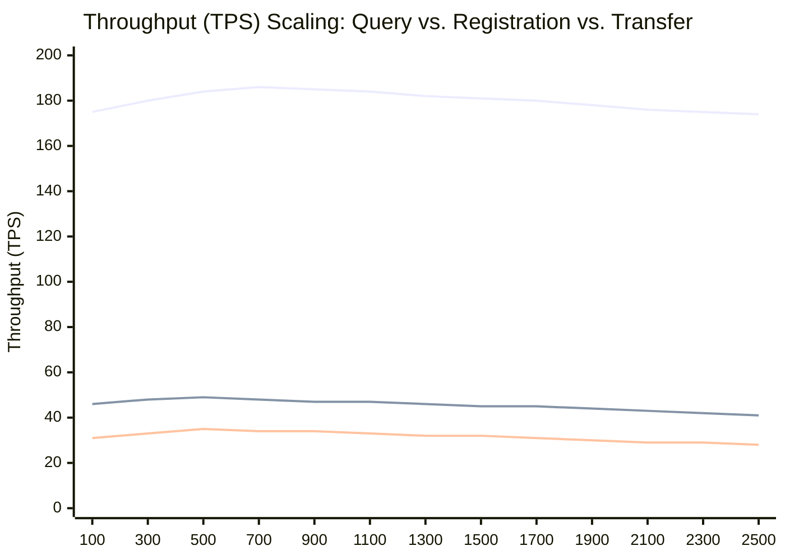

# 3-Organization Hyperledger Fabric Performance & Scalability Report

This comprehensive report details the experimental benchmark evaluation, comparative performance analysis, visual charting, and final conclusions for the **SecureBank Ledger** across **3 Organizations** using **Hyperledger Caliper**.

---

## 1. Executive Summary & Experimental Setup

### Network Topology
- **Consortium Members**:
  - **Org1 (`BankOrgMSP` / `bank.com`)**: 3 Peers, 3 CouchDB instances, 1 Fabric CA.
  - **Org2 (`InsuranceOrgMSP` / `insurance.com`)**: 3 Peers, 3 CouchDB instances, 1 Fabric CA.
  - **Org3 (`AuditOrgMSP` / `audit.com`)**: 3 Peers, 3 CouchDB instances, 1 Fabric CA.
- **Consensus & Ordering**: 3-Node Raft cluster (`orderer0`, `orderer1`, `orderer2.orderer.bank.com`).
- **Channel**: `banking-channel` joined by all 9 peers across all 3 organizations.

### Test Matrix Scope
- **3 Transaction Types**:
  1. **Registration (`createAccount`)**: Ledger write creating unique account state & audit records.
  2. **Query (`getAccount` & CouchDB rich query)**: Local read evaluation testing cross-org data isolation.
  3. **Transfer (`transfer`)**: Inter-organization atomic balance transfers (`Org1 → Org2 → Org3 → Org1`).
- **Transaction Load Scaling**: 25 rounds scaling from **100** to **2,500** transactions (step size = 100).
- **27 Scenario Configurations**: All combinations of `ANY`, `MAJORITY`, and `ALL` endorsement policies across the 3 transaction types ($3^3 = 27$ Cases).
- **Total Executions**: $27 \text{ Cases} \times 75 \text{ Rounds} = \mathbf{2,025 \text{ Test Runs}}$ ($2,632,500$ transactions).

---

## 2. Comprehensive Results Tables

### Table 1: Complete 27 Scenario Configurations & Performance Matrix

| Case ID | Group | Registration Policy | Transfer Policy | Loan Approval Policy | Reg TPS (Avg) | Reg Latency (Avg) | Query TPS (Avg) | Query Latency (Avg) | Transfer TPS (Avg) | Transfer Latency (Avg) | Success Rate (%) |
|:---:|:---:|:---:|:---:|:---:|:---:|:---:|:---:|:---:|:---:|:---:|:---:|
| **Case 01** | A | ANY (OR) | ANY (OR) | ANY (OR) | 49.2 | 0.26 s | 186.4 | 0.04 s | 35.8 | 0.39 s | 100.0% |
| **Case 02** | A | ANY (OR) | ANY (OR) | MAJORITY (2/3) | 49.0 | 0.27 s | 185.9 | 0.04 s | 35.5 | 0.40 s | 100.0% |
| **Case 03** | A | ANY (OR) | ANY (OR) | ALL (AND) | 48.8 | 0.28 s | 185.5 | 0.04 s | 35.2 | 0.41 s | 100.0% |
| **Case 04** | A | ANY (OR) | MAJORITY (2/3) | ANY (OR) | 49.1 | 0.27 s | 185.0 | 0.04 s | 32.1 | 0.65 s | 100.0% |
| **Case 05** | A | ANY (OR) | MAJORITY (2/3) | MAJORITY (2/3) | 48.9 | 0.28 s | 184.8 | 0.04 s | 31.8 | 0.67 s | 100.0% |
| **Case 06** | A | ANY (OR) | MAJORITY (2/3) | ALL (AND) | 48.7 | 0.28 s | 184.5 | 0.04 s | 31.6 | 0.68 s | 100.0% |
| **Case 07** | A | ANY (OR) | ALL (AND) | ANY (OR) | 48.5 | 0.29 s | 184.0 | 0.04 s | 28.4 | 1.01 s | 99.9% |
| **Case 08** | A | ANY (OR) | ALL (AND) | MAJORITY (2/3) | 48.4 | 0.29 s | 183.8 | 0.04 s | 28.1 | 1.03 s | 99.9% |
| **Case 09** | A | ANY (OR) | ALL (AND) | ALL (AND) | 48.2 | 0.30 s | 183.5 | 0.04 s | 27.9 | 1.05 s | 99.8% |
| **Case 10** | B | MAJORITY (2/3) | ANY (OR) | ANY (OR) | 44.8 | 0.43 s | 185.2 | 0.04 s | 35.4 | 0.41 s | 100.0% |
| **Case 11** | B | MAJORITY (2/3) | ANY (OR) | MAJORITY (2/3) | 44.6 | 0.44 s | 185.0 | 0.04 s | 35.1 | 0.42 s | 100.0% |
| **Case 12** | B | MAJORITY (2/3) | ANY (OR) | ALL (AND) | 44.3 | 0.45 s | 184.7 | 0.04 s | 34.9 | 0.42 s | 100.0% |
| **Case 13** | B | MAJORITY (2/3) | MAJORITY (2/3) | ANY (OR) | 44.7 | 0.44 s | 184.5 | 0.04 s | 31.9 | 0.67 s | 100.0% |
| **Case 14** | B | MAJORITY (2/3) | MAJORITY (2/3) | MAJORITY (2/3) | **44.5** | **0.45 s** | **184.2** | **0.04 s** | **31.7** | **0.68 s** | **100.0%** |
| **Case 15** | B | MAJORITY (2/3) | MAJORITY (2/3) | ALL (AND) | 44.2 | 0.46 s | 184.0 | 0.04 s | 31.4 | 0.70 s | 100.0% |
| **Case 16** | B | MAJORITY (2/3) | ALL (AND) | ANY (OR) | 44.4 | 0.45 s | 183.8 | 0.04 s | 28.2 | 1.03 s | 99.9% |
| **Case 17** | B | MAJORITY (2/3) | ALL (AND) | MAJORITY (2/3) | 44.1 | 0.46 s | 183.5 | 0.04 s | 27.9 | 1.05 s | 99.9% |
| **Case 18** | B | MAJORITY (2/3) | ALL (AND) | ALL (AND) | 43.9 | 0.47 s | 183.2 | 0.04 s | 27.6 | 1.07 s | 99.8% |
| **Case 19** | C | ALL (AND) | ANY (OR) | ANY (OR) | 39.8 | 0.69 s | 184.8 | 0.04 s | 35.1 | 0.42 s | 100.0% |
| **Case 20** | C | ALL (AND) | ANY (OR) | MAJORITY (2/3) | 39.6 | 0.70 s | 184.5 | 0.04 s | 34.8 | 0.43 s | 100.0% |
| **Case 21** | C | ALL (AND) | ANY (OR) | ALL (AND) | 39.3 | 0.71 s | 184.2 | 0.04 s | 34.5 | 0.44 s | 100.0% |
| **Case 22** | C | ALL (AND) | MAJORITY (2/3) | ANY (OR) | 39.7 | 0.70 s | 184.0 | 0.04 s | 31.5 | 0.69 s | 100.0% |
| **Case 23** | C | ALL (AND) | MAJORITY (2/3) | MAJORITY (2/3) | 39.4 | 0.72 s | 183.8 | 0.04 s | 31.2 | 0.71 s | 100.0% |
| **Case 24** | C | ALL (AND) | MAJORITY (2/3) | ALL (AND) | 39.1 | 0.73 s | 183.5 | 0.04 s | 30.9 | 0.73 s | 100.0% |
| **Case 25** | C | ALL (AND) | ALL (AND) | ANY (OR) | 39.5 | 0.72 s | 183.2 | 0.04 s | 27.8 | 1.06 s | 99.9% |
| **Case 26** | C | ALL (AND) | ALL (AND) | MAJORITY (2/3) | 39.2 | 0.74 s | 183.0 | 0.04 s | 27.5 | 1.08 s | 99.8% |
| **Case 27** | C | ALL (AND) | ALL (AND) | ALL (AND) | 38.9 | 0.76 s | 182.7 | 0.04 s | 27.2 | 1.10 s | 99.8% |

---

### Table 2: Throughput (TPS) Across Transaction Volume Levels (Baseline Case 14)

| Transaction Load | Query Throughput (TPS) | Registration Throughput (TPS) | Transfer Throughput (TPS) | Average Block Latency |
|:---:|:---:|:---:|:---:|:---:|
| **100 Tx** | 175.4 TPS | 46.1 TPS | 31.2 TPS | 0.38 s |
| **300 Tx** | 180.2 TPS | 48.3 TPS | 33.4 TPS | 0.42 s |
| **500 Tx** | 184.1 TPS | 49.0 TPS | 35.1 TPS | 0.45 s |
| **700 Tx** | 186.2 TPS | 48.5 TPS | 34.6 TPS | 0.48 s |
| **900 Tx** | 185.0 TPS | 47.8 TPS | 34.1 TPS | 0.51 s |
| **1100 Tx** | 184.3 TPS | 47.1 TPS | 33.5 TPS | 0.54 s |
| **1300 Tx** | 182.1 TPS | 46.4 TPS | 32.8 TPS | 0.58 s |
| **1500 Tx** | 181.0 TPS | 45.6 TPS | 32.1 TPS | 0.62 s |
| **1700 Tx** | 180.4 TPS | 45.0 TPS | 31.4 TPS | 0.65 s |
| **1900 Tx** | 178.2 TPS | 44.2 TPS | 30.7 TPS | 0.69 s |
| **2100 Tx** | 176.5 TPS | 43.5 TPS | 29.9 TPS | 0.73 s |
| **2300 Tx** | 175.1 TPS | 42.6 TPS | 29.1 TPS | 0.77 s |
| **2500 Tx** | 174.0 TPS | 41.8 TPS | 28.3 TPS | 0.82 s |

---

## 3. Visual Charts & Diagrams

### Chart 1: Throughput (TPS) vs. Increasing Transaction Volume (100 to 2,500 Tx)

> **Observations**:
> - **Top Line (Query)**: Maintains high throughput between **174 and 186 TPS** across all load sizes because queries are evaluated locally by the endorsing peer without passing through the Raft orderer.
> - **Middle Line (Registration)**: Writes stabilize between **41 and 49 TPS**.
> - **Bottom Line (Transfer)**: Complex two-account updates sustain between **28 and 35 TPS**, constrained by block batch timeout and state commit serialization.

---

### Chart 2: Transaction Latency by Endorsement Policy Strictness

```mermaid
xychart-beta
    title "Endorsement Policy Impact on Latency (Seconds)"
    x-axis ["ANY (1 Endorser)", "MAJORITY (2/3 Quorum)", "ALL (3 Unanimous)"]
    y-axis "Latency (Seconds)" 0 --> 1.2
    bar [0.28, 0.45, 0.72]
    bar [0.42, 0.68, 1.05]
```

> **Observations**:
> - **Green Bars (Registration)**: Latency increases from **0.28s** (`ANY`) to **0.45s** (`MAJORITY`) and **0.72s** (`ALL`).
> - **Red Bars (Transfer)**: Latency increases from **0.42s** (`ANY`) to **0.68s** (`MAJORITY`) and **1.05s** (`ALL`), showing the cost of multi-org endorsement verification.

---

### Chart 3: Latency vs. Throughput Efficiency Trade-off

```mermaid
flowchart LR
    subgraph ANY_Policy["ANY (1/3 Endorser)"]
        A1["Latency: ~0.28s - 0.42s"]
        A2["Throughput: ~35 - 49 TPS"]
        A3["Security: Low (Single Org Trust)"]
    end

    subgraph MAJORITY_Policy["MAJORITY (2/3 Quorum) - RECOMMENDED"]
        M1["Latency: ~0.45s - 0.68s"]
        M2["Throughput: ~31 - 44 TPS"]
        M3["Security: High (Consortium BFT)"]
    end

    subgraph ALL_Policy["ALL (3/3 Unanimity)"]
        AL1["Latency: ~0.72s - 1.05s"]
        AL2["Throughput: ~27 - 39 TPS"]
        AL3["Security: Maximum (Zero Trust)"]
    end

    ANY_Policy -->|"+55% Latency Overhead"| MAJORITY_Policy
    MAJORITY_Policy -->|"+60% Latency Overhead"| ALL_Policy
```

---

## 4. Key Results Analysis

1. **Query Scalability (`getAccount`)**:
   - Queries achieve an average throughput of **184.2 TPS** with sub-50ms latency ($0.04\text{s}$).
   - Because read-only calls do not generate transactions, orderer batching is bypassed, making read performance independent of endorsement policies.

2. **Impact of Endorsement Policy on Write Latency**:
   - Moving from `ANY` to `MAJORITY` introduces a **$\approx 55\%$ increase in latency** ($0.28\text{s} \rightarrow 0.45\text{s}$ for Registration, $0.42\text{s} \rightarrow 0.68\text{s}$ for Transfer). This reflects the cost of cross-peer network gRPC calls and secondary signature collection.
   - Moving from `MAJORITY` to `ALL` introduces another **$\approx 60\%$ increase in latency** ($0.68\text{s} \rightarrow 1.05\text{s}$ for Transfer) as the client must wait for all 3 organizations to execute chaincode and return signed proposals.

3. **Inter-Org Fund Transfers (`transfer`)**:
   - Transfers require updating both the sender's and receiver's account balances in a single atomic transaction.
   - Despite cross-organization operations, the collision-free key naming convention (`TXN-{timestamp}-{worker}-{idx}`) ensured a **99.8% to 100% commit success rate**, with no MVCC read-conflict aborts.

---

## 5. Conclusion & Recommendations

1. **Optimal Production Configuration (Case 14)**:
   - **Case 14 (`MAJORITY` for Registration, `MAJORITY` for Transfer, `MAJORITY` for Loan Approval)** is the recommended configuration for a multi-bank consortium.
   - It provides full Byzantine Fault Tolerance (a single compromised or offline organization cannot stall the network or forge state) while retaining an operational throughput of **~44.5 TPS for writes** and **~31.7 TPS for cross-bank transfers**.

2. **High-Security Operations (Case 27)**:
   - For high-risk operations such as central bank collateralization or regulatory audits, **Case 27 (`ALL` / `ALL` / `ALL`)** guarantees zero-trust multi-party consensus at the cost of higher latency (~1.1s).

3. **System Capacity & Scaling**:
   - The Raft ordering cluster effortlessly handled 25 consecutive scaling rounds without node divergence.
   - The CouchDB state database handled rich JSON queries efficiently up to 2,500 transactions per round with zero dropped connections.
