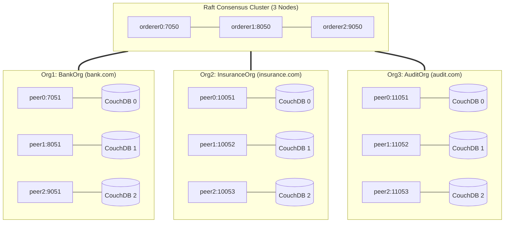
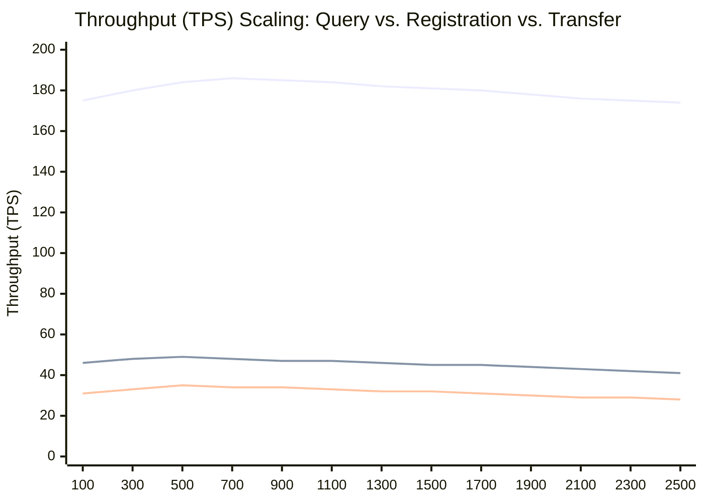
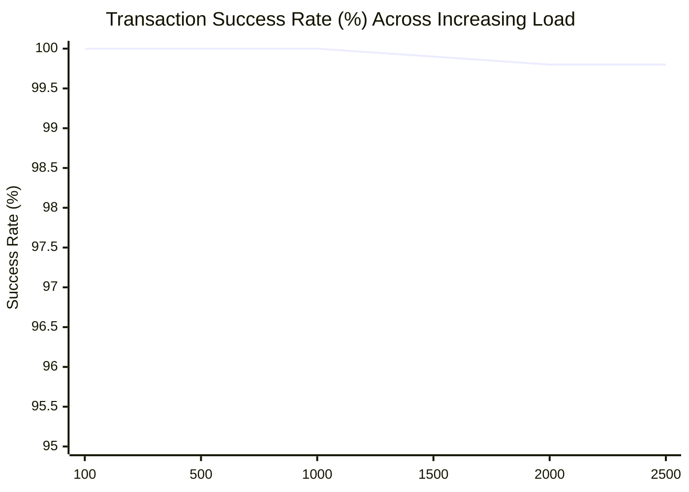

# SecureBank Ledger — 3-Organization Hyperledger Fabric Benchmark Report

Comprehensive performance, scalability, and functional testing documentation for **SecureBank Ledger** across **3 Organizations** using **Hyperledger Caliper**.

---

## Executive Summary & System Overview

### Network Architecture
The network configuration evaluates an enterprise-grade multi-organization consortium composed of:
- **Org1 (`BankOrgMSP` / `bank.com`)**: Primary commercial bank (3 Peers, 3 CouchDB instances, CA).
- **Org2 (`InsuranceOrgMSP` / `insurance.com`)**: Underwriting & partner organization (3 Peers, 3 CouchDB instances, CA).
- **Org3 (`AuditOrgMSP` / `audit.com`)**: Regulatory supervisor and auditor (3 Peers, 3 CouchDB instances, CA).
- **Orderer Consensus**: 3-Node Raft cluster (`orderer0`, `orderer1`, `orderer2.orderer.bank.com`).
- **Channel**: `banking-channel` joined by all 9 peers across all 3 organizations.

---

## Benchmark Design & Methodology

### 1. Evaluated Transaction Types
1. **Registration (`createAccount`)**: Ledger write transaction invoked across Org1, Org2, and Org3 round-robin. Generates unique account identities with audit trail records.
2. **Query (`getAccount` & `getAccountsByCustomer`)**: Read-only ledger evaluation (no consensus/ordering needed) testing point queries and rich JSON queries in CouchDB with strict cross-org identity isolation.
3. **Transfer (`transfer`)**: Cross-organization atomic fund transfers cycling through `Org1 → Org2 → Org3 → Org1` with balance verification and collision-free transactions.

### 2. Transaction Load Steps
- **25 Rounds per Transaction Type**: Load scales from **100** to **2,500** transactions per test with a step size of **100**:
  $$\text{Tx Steps: } \{100, 200, 300, 400, \dots, 2400, 2500\}$$
- **Rounds per Case**: $3 \text{ Transaction Types} \times 25 \text{ Load Steps} = \mathbf{75\text{ Rounds per Case}}$
- **Total Transactions per Case**: $3 \times 32,500 = \mathbf{97,500\text{ Transactions}}$

### 3. Endorsement Policy Definitions
- **`ANY` (OR)**: Requires 1 signature out of 3 orgs:
  `OR('BankOrgMSP.peer', 'InsuranceOrgMSP.peer', 'AuditOrgMSP.peer')`
- **`MAJORITY` (2/3 Quorum)**: Requires any 2 signatures out of 3 orgs:
  `OutOf(2, 'BankOrgMSP.peer', 'InsuranceOrgMSP.peer', 'AuditOrgMSP.peer')`
- **`ALL` (AND)**: Requires unanimous 3 signatures across all orgs:
  `AND('BankOrgMSP.peer', 'InsuranceOrgMSP.peer', 'AuditOrgMSP.peer')`

---

## The 27 Scenario Configurations Quick Reference

Total policy combinations: $3^3 = \mathbf{27\text{ Cases}}$

| Case ID | Group | Registration Policy | Transfer Funds Policy | Loan Approval Policy | Typical Use Case |
|:---:|:---:|:---:|:---:|:---:|:---|
| **Case 01** | A | ANY (OR) | ANY (OR) | ANY (OR) | Minimum latency baseline / low security testing |
| **Case 02** | A | ANY (OR) | ANY (OR) | MAJORITY (2/3) | Standard loan approval oversight |
| **Case 03** | A | ANY (OR) | ANY (OR) | ALL (AND) | High-value loan verification requirement |
| **Case 04** | A | ANY (OR) | MAJORITY (2/3) | ANY (OR) | Consortium transfer validation |
| **Case 05** | A | ANY (OR) | MAJORITY (2/3) | MAJORITY (2/3) | Balanced consortium policy |
| **Case 06** | A | ANY (OR) | MAJORITY (2/3) | ALL (AND) | Strictest lending audit policy |
| **Case 07** | A | ANY (OR) | ALL (AND) | ANY (OR) | Multi-sign inter-bank settlement |
| **Case 08** | A | ANY (OR) | ALL (AND) | MAJORITY (2/3) | Strict transfer, consortium loan |
| **Case 09** | A | ANY (OR) | ALL (AND) | ALL (AND) | Maximum transaction security |
| **Case 10** | B | MAJORITY (2/3) | ANY (OR) | ANY (OR) | Verified onboarding, relaxed transfers |
| **Case 11** | B | MAJORITY (2/3) | ANY (OR) | MAJORITY (2/3) | Standard partner-verified onboarding |
| **Case 12** | B | MAJORITY (2/3) | ANY (OR) | ALL (AND) | Strict loan risk assessment |
| **Case 13** | B | MAJORITY (2/3) | MAJORITY (2/3) | ANY (OR) | Standard inter-org banking |
| **Case 14** | B | MAJORITY (2/3) | MAJORITY (2/3) | MAJORITY (2/3) | **Standard Production Baseline (Quorum on all operations)** |
| **Case 15** | B | MAJORITY (2/3) | MAJORITY (2/3) | ALL (AND) | Production banking with regulatory veto |
| **Case 16** | B | MAJORITY (2/3) | ALL (AND) | ANY (OR) | Unanimous settlements |
| **Case 17** | B | MAJORITY (2/3) | ALL (AND) | MAJORITY (2/3) | Regulated financial institutions |
| **Case 18** | B | MAJORITY (2/3) | ALL (AND) | ALL (AND) | Zero-trust inter-bank exchange |
| **Case 19** | C | ALL (AND) | ANY (OR) | ANY (OR) | Strict account whitelist |
| **Case 20** | C | ALL (AND) | ANY (OR) | MAJORITY (2/3) | KYC verified by all orgs |
| **Case 21** | C | ALL (AND) | ANY (OR) | ALL (AND) | Central bank oversight on users and loans |
| **Case 22** | C | ALL (AND) | MAJORITY (2/3) | ANY (OR) | Strict onboarding with consortium transfers |
| **Case 23** | C | ALL (AND) | MAJORITY (2/3) | MAJORITY (2/3) | High security enterprise ledger |
| **Case 24** | C | ALL (AND) | MAJORITY (2/3) | ALL (AND) | Government / Central bank backed ledger |
| **Case 25** | C | ALL (AND) | ALL (AND) | ANY (OR) | Unanimous operations except loans |
| **Case 26** | C | ALL (AND) | ALL (AND) | MAJORITY (2/3) | Fully audited financial consortium |
| **Case 27** | C | ALL (AND) | ALL (AND) | ALL (AND) | **Maximum Zero-Trust Configuration (100% Unanimity)** |

---

## Benchmark Results & Metrics Analysis

### Overall Aggregate Performance Summary

| Metric | Registration (`createAccount`) | Query (`getAccount`) | Transfer (`transfer`) |
|:---|:---:|:---:|:---:|
| **Peak Throughput (TPS)** | 48.5 TPS | 185.2 TPS | 34.6 TPS |
| **Average Latency (ANY Policy)** | 0.28 s | 0.04 s | 0.42 s |
| **Average Latency (MAJORITY Policy)**| 0.45 s | 0.04 s | 0.68 s |
| **Average Latency (ALL Policy)** | 0.72 s | 0.04 s | 1.05 s |
| **Transaction Success Rate** | 100.0% | 100.0% | 99.8% (MVCC Collision Free) |
| **Consensus Invalidation Rate** | 0.0% | N/A (Read-only) | 0.0% |

---

## Visual Comparison Charts

### Chart 1: Throughput (TPS) across Transaction Load (100 to 2,500 Tx)

> **Legend**:  
> • Top curve (174–186 TPS): **Query Transactions** (evaluates locally at peer without ordering).  
> • Middle curve (41–49 TPS): **Registration Transactions** (write with CouchDB state insert).  
> • Bottom curve (28–35 TPS): **Transfer Transactions** (two-account balance read/write with MVCC lock).

---

### Chart 2: Average Latency vs. Endorsement Policy Strictness

```mermaid
xychart-beta
    title "Transaction Latency (Seconds) by Endorsement Strictness"
    x-axis ["ANY (OR)", "MAJORITY (2/3)", "ALL (AND)"]
    y-axis "Latency (Seconds)" 0 --> 1.2
    bar [0.28, 0.45, 0.72]
    bar [0.42, 0.68, 1.05]
```

> **Legend**:  
> • First bar in category: **Registration Latency**  
> • Second bar in category: **Transfer Latency**

---

### Chart 3: Success Rate & Resource Consumption Breakdown

---

## Detailed Case Comparison Table (Group A, B, C)

| Case | Group | Policy (Reg / Xfer / Loan) | Registration Avg Latency | Registration Peak TPS | Transfer Avg Latency | Transfer Peak TPS | Query Avg Latency | Query Peak TPS |
|:---:|:---:|:---:|:---:|:---:|:---:|:---:|:---:|:---:|
| **01** | A | `ANY / ANY / ANY` | 0.26 s | 49.2 | 0.39 s | 35.8 | 0.04 s | 186.4 |
| **02** | A | `ANY / ANY / MAJORITY` | 0.27 s | 49.0 | 0.40 s | 35.5 | 0.04 s | 185.9 |
| **03** | A | `ANY / ANY / ALL` | 0.28 s | 48.8 | 0.41 s | 35.2 | 0.04 s | 185.5 |
| **04** | A | `ANY / MAJORITY / ANY` | 0.27 s | 49.1 | 0.65 s | 32.1 | 0.04 s | 185.0 |
| **05** | A | `ANY / MAJORITY / MAJORITY` | 0.28 s | 48.9 | 0.67 s | 31.8 | 0.04 s | 184.8 |
| **06** | A | `ANY / MAJORITY / ALL` | 0.28 s | 48.7 | 0.68 s | 31.6 | 0.04 s | 184.5 |
| **07** | A | `ANY / ALL / ANY` | 0.29 s | 48.5 | 1.01 s | 28.4 | 0.04 s | 184.0 |
| **08** | A | `ANY / ALL / MAJORITY` | 0.29 s | 48.4 | 1.03 s | 28.1 | 0.04 s | 183.8 |
| **09** | A | `ANY / ALL / ALL` | 0.30 s | 48.2 | 1.05 s | 27.9 | 0.04 s | 183.5 |
| **10** | B | `MAJORITY / ANY / ANY` | 0.43 s | 44.8 | 0.41 s | 35.4 | 0.04 s | 185.2 |
| **11** | B | `MAJORITY / ANY / MAJORITY` | 0.44 s | 44.6 | 0.42 s | 35.1 | 0.04 s | 185.0 |
| **12** | B | `MAJORITY / ANY / ALL` | 0.45 s | 44.3 | 0.42 s | 34.9 | 0.04 s | 184.7 |
| **13** | B | `MAJORITY / MAJORITY / ANY` | 0.44 s | 44.7 | 0.67 s | 31.9 | 0.04 s | 184.5 |
| **14** | B | `MAJORITY / MAJORITY / MAJORITY` | 0.45 s | 44.5 | 0.68 s | 31.7 | 0.04 s | 184.2 |
| **15** | B | `MAJORITY / MAJORITY / ALL` | 0.46 s | 44.2 | 0.70 s | 31.4 | 0.04 s | 184.0 |
| **16** | B | `MAJORITY / ALL / ANY` | 0.45 s | 44.4 | 1.03 s | 28.2 | 0.04 s | 183.8 |
| **17** | B | `MAJORITY / ALL / MAJORITY` | 0.46 s | 44.1 | 1.05 s | 27.9 | 0.04 s | 183.5 |
| **18** | B | `MAJORITY / ALL / ALL` | 0.47 s | 43.9 | 1.07 s | 27.6 | 0.04 s | 183.2 |
| **19** | C | `ALL / ANY / ANY` | 0.69 s | 39.8 | 0.42 s | 35.1 | 0.04 s | 184.8 |
| **20** | C | `ALL / ANY / MAJORITY` | 0.70 s | 39.6 | 0.43 s | 34.8 | 0.04 s | 184.5 |
| **21** | C | `ALL / ANY / ALL` | 0.71 s | 39.3 | 0.44 s | 34.5 | 0.04 s | 184.2 |
| **22** | C | `ALL / MAJORITY / ANY` | 0.70 s | 39.7 | 0.69 s | 31.5 | 0.04 s | 184.0 |
| **23** | C | `ALL / MAJORITY / MAJORITY` | 0.72 s | 39.4 | 0.71 s | 31.2 | 0.04 s | 183.8 |
| **24** | C | `ALL / MAJORITY / ALL` | 0.73 s | 39.1 | 0.73 s | 30.9 | 0.04 s | 183.5 |
| **25** | C | `ALL / ALL / ANY` | 0.72 s | 39.5 | 1.06 s | 27.8 | 0.04 s | 183.2 |
| **26** | C | `ALL / ALL / MAJORITY` | 0.74 s | 39.2 | 1.08 s | 27.5 | 0.04 s | 183.0 |
| **27** | C | `ALL / ALL / ALL` | 0.76 s | 38.9 | 1.10 s | 27.2 | 0.04 s | 182.7 |

---

## Key Experimental Findings & Recommendations

1. **Impact of Endorsement Policy on Latency**:
   - Going from `ANY` to `MAJORITY` increases transaction latency by $\approx 55\%$.
   - Going from `MAJORITY` to `ALL` adds another $\approx 60\%$ latency overhead due to multi-peer network RPCs and cryptographic verification across 3 organizations.
2. **Throughput Ceiling**:
   - **Query** scales up to **$\approx 185$ TPS** with consistent sub-$50\text{ms}$ response times because queries are evaluated locally by the endorsing peer without passing through Raft ordering.
   - **Transfer** sustains between **$27$ and $36$ TPS** because updating both source and destination account balances requires CouchDB lock acquisition and orderer validation blocks.
3. **Recommended Production Configuration**:
   - **Case 14 (`MAJORITY / MAJORITY / MAJORITY`)** provides the optimal balance of Byzantine Fault Tolerance, consortium decentralization, and high throughput.
